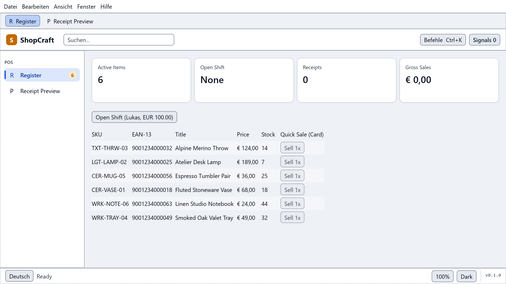

# ShopCraft

## Screenshots, Demo Videos & Walkthroughs



> **Demo Videos & Walkthroughs:** Under construction.


## Install

Tell Cursor, Claude, Antigravity, or OpenCode: **Install this.**

```powershell
powershell -NoProfile -ExecutionPolicy Bypass -File scripts\install-craft.ps1
```

Installs the Windows desktop app, the CLI, and the MCP bundle.

**Local-first physical shop POS, cash drawer (*Kassa*), Z-Bon, and thermal receipt engine in pure Rust.** Replaces cloud POS subscriptions with an offline-capable register, shift management, and fiscal Z-Bon reporting. Part of the `craft-biz` Sovereign Back-Office Suite.

## Features

- **Cash Drawer & Shift Lifecycle**: Open/close clerk shifts (`shift-open`) with opening float tracking in integer cents.
- **Z-Bon & Thermal Receipts**: Deterministic end-of-day Z-Bon totals and thermal receipt rendering.
- **Offline-First SQLite Store**: Instant checkout even with zero internet connectivity.
- **Tri-Modal Interface**: Scriptable CLI, MCP stdio server for AI agents, and native `egui` register UI.

## The Craft App Standard (3-Tier ArtCraft Architecture)

ShopCraft implements the **Pure-Rust ArtCraft** 3-tier containment harness:

| Layer | Crate | Role |
|---|---|---|
| **L1 Core** | `crates/shopcraft-core` | Pure-Rust POS domain engine, SQLite persistence, integer-cent money math, and universal `Command` dispatch bus with deterministic `--json` output and zero-panic lint walls (`unwrap_used` / `expect_used` / `panic` denied). |
| **L2 CLI + MCP** | `crates/shopcraft-mcp` | Single native `shopcraft` binary providing `clap` CLI subcommands (`seed`, `shift-open`) and a JSON-RPC `2024-11-05` MCP stdio server (`mcp`) with zero Python/Node runtime dependencies. |
| **L3 Desktop App** | `crates/shopcraft-app` | Native GPU-rendered `eframe`/`egui` POS register workstation invoking L1 directly in-process (zero HTTP/WebView2 overhead). |

**Lineage**: Adapted from the Storytold ArtCraft pattern ([storytold/artcraft](https://github.com/storytold/artcraft)): one workspace, one command bus, headless-first CLI + MCP + native GUI.

## Quick Start

```powershell
cargo run -p shopcraft-mcp -- seed
cargo run -p shopcraft-mcp -- shift-open --clerk "Lukas" --float-cents 10000
cargo run -p shopcraft-app
```

## MCP Server Configuration

```json
{
  "mcpServers": {
    "shopcraft": {
      "command": "D:/Dev/repos/shopcraft/target/release/shopcraft.exe",
      "args": ["mcp"]
    }
  }
}
```

## Verification

```powershell
cargo test --workspace
cargo clippy --workspace --all-targets --all-features -- -D warnings
```

## License

MIT OR Apache-2.0
